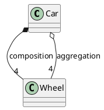

<!---
{
  "id": "e84b5dcf-9e1b-4dfd-8964-f14b4bbf3333",
  "teaches": "Cpp: Aggregation versus Composition, and a Makefile for C++",
  "depends_on": [
    "f51efa1c-ef4b-41e0-a6c9-3fcd0b95a155",
    "0432aac4-3185-48c6-a493-97b617687ecf"
  ],
  "author": "Stephan Bökelmann",
  "first_used": "2026-10-08",
  "keywords": [
    "C++",
    "composition",
    "aggregation",
    "ownership",
    "member object",
    "pointer member",
    "destructor order",
    "Makefile",
    "g++",
    "CXX"
  ]
}
--->

# Cpp: Aggregation versus Composition, and a Makefile for C++

> In this exercise you model a car and its wheels twice: once as composition (the wheels are part of the car and die with it) and once as aggregation (the wheels exist on their own and the car only refers to them). You will watch constructor and destructor order prove the difference, then move the whole thing into a small multi-file C++ project with a Makefile. No `sudo` is required.

## Introduction

Objects relate to each other. The lecture distinguishes two kinds of "has a":

- **Composition** (owning): the child is constructed inside the parent and destroyed with it. In C++ this is a member object. When the car is built, the wheels are built; when the car is scrapped, so are the wheels.
- **Aggregation** (non-owning): the child exists independently; the parent holds a pointer or reference. The wheels were made first and bolted on; scrapping the car leaves them in the garage.

The choice is not cosmetic. It decides who calls the destructor, whether two parents may share a child, and what happens if the child outlives the parent, which is exactly the dangling-pointer situation from the heap chapter. The `Makefile` part makes sure you can build a C++ project with the tooling from chapter 19: same rules, `CXX` and `CXXFLAGS` instead of `CC` and `CFLAGS`.

### 1.1) Further Readings and Other Sources

* [C++ Core Guidelines: C.4, C.8, C.9; R.20 to R.24 (ownership)](https://isocpp.github.io/CppCoreGuidelines/CppCoreGuidelines#S-class)
* [cppreference: Member initializer list and construction order](https://en.cppreference.com/w/cpp/language/constructor)
* [GNU Make Manual: Implicit variables (`CXX`, `CXXFLAGS`)](https://www.gnu.org/software/make/manual/html_node/Implicit-Variables.html)

## Tasks

### Task 1: Composition

```bash
mkdir -p ~/oop-8 && cd ~/oop-8
```

```c++
// file: wheel.h
#pragma once
#include <cstdio>
class Wheel {
public:
    Wheel(int pos) : pos(pos) { std::printf("  wheel %d made\n", pos); }
    ~Wheel()                  { std::printf("  wheel %d scrapped\n", pos); }
    int pos;
};
```

```c++
// file: car_comp.cpp
#include "wheel.h"
class Car {
public:
    Car()  { std::printf("car assembled\n"); }
    ~Car() { std::printf("car scrapped\n"); }
private:
    Wheel w[4] = { {1}, {2}, {3}, {4} };     // composition: members
};
int main() { { Car c; std::printf("driving\n"); } std::printf("after car\n"); }
```

```bash
g++ -Wall -Wextra car_comp.cpp -o car_comp && ./car_comp
```

Wheels are made *before* the car's constructor body and scrapped *after* its destructor body, in reverse order. The car owns them.

### Task 2: Aggregation

```c++
// file: car_agg.cpp
#include "wheel.h"
class Car {
public:
    Car(Wheel *a, Wheel *b, Wheel *c, Wheel *d) : w{a, b, c, d} { std::printf("car assembled\n"); }
    ~Car() { std::printf("car scrapped\n"); }
private:
    Wheel *w[4];                             // aggregation: pointers
};
int main() {
    Wheel w1(1), w2(2), w3(3), w4(4);
    { Car c(&w1, &w2, &w3, &w4); std::printf("driving\n"); }
    std::printf("after car: wheels still here\n");
}
```

Run and compare the output. The wheels survive the car. Now swap the order: create the car in the outer scope and the wheels in an inner one, and let the car use a wheel after the inner scope ended. Run it under `valgrind` or with `-fsanitize=address` and read the report: the aggregation left a dangling pointer. Who is responsible for the lifetime?

### Task 3: Sharing

Only aggregation allows sharing. Create two cars that both point at `w1`. Then try to do the same with the composition version and explain why it is impossible by construction.

### Task 4: Composition with a pointer member (owning pointer)

A third form: the parent `new`s the child in its constructor and `delete`s it in its destructor.

```c++
class Car {
public:
    Car() : spare(new Wheel(5)) {}
    ~Car() { delete spare; }
private:
    Wheel *spare;
};
```

This is still composition (owning), but now the copy problem from the earlier exercises returns: copy the car and both destructors delete the same wheel. Make the class uncopyable (`Car(const Car&) = delete; Car& operator=(const Car&) = delete;`) and verify that the compiler now rejects the copy. The rule-of-five chapter will show the proper alternatives (`std::unique_ptr`).

### Task 5: Split into files

Create `car.h`, `car.cpp`, `wheel.h`, `wheel.cpp` (move the constructor bodies out of the header) and `main.cpp`. Then write the `Makefile` with the pattern from chapter 19, adapted for C++:

```make
CXX      := g++
CXXFLAGS := -Wall -Wextra -std=c++17 -g -MMD -MP
SRCS     := $(wildcard *.cpp)
OBJS     := $(SRCS:.cpp=.o)

all: car

car: $(OBJS)
	$(CXX) $(CXXFLAGS) $^ -o $@

%.o: %.cpp
	$(CXX) $(CXXFLAGS) -c $< -o $@

clean:
	rm -f $(OBJS) $(OBJS:.o=.d) car

.PHONY: all clean
-include $(OBJS:.o=.d)
```

```bash
make && ./car
touch wheel.h && make      # which objects are rebuilt, and why?
```

### Task 6: A static library of classes

Reuse the archive exercise: build `libvehicles.a` from `wheel.o` and `car.o`, link `main.o` against it, and check with `nm -C libvehicles.a` that the constructors and destructors are there as mangled symbols. Then link the same archive from a program compiled with `gcc`: read the error and explain why a C++ library needs `g++` (or `-lstdc++`) at link time.

### Task 7: Draw it

Draw the two class diagrams (composition with a filled diamond, aggregation with an empty diamond) in PlantUML:



Render with `plantuml -tpng` and put the picture next to the code. UML has the two notations because the lifetime semantics differ.

## Questions

- In which order are wheels and car constructed and destroyed under composition, and why?
- Under aggregation, who owns the wheels, and what can go wrong if the owner is careless?
- Why is sharing possible only with aggregation?
- Task 4: which bug does the copy of an owning-pointer class produce, and how did you make it impossible?
- Which lines of the C Makefile from chapter 19 changed for C++, and which stayed? Why does `make` already know `CXX`?
- Why does linking a C++ archive from `gcc` fail, and what does `g++` add?

## Advice

Ask of every "has a": does the child die with the parent? If yes, make it a member (composition) and let the compiler manage the lifetime. If no, hold a pointer or reference (aggregation) and write down who owns the child. Most lifetime bugs in C++ are aggregations that were never assigned an owner.

The Makefile shows that the C++ toolchain is the C toolchain with a different front end. Everything from chapters 18 and 19, archives, `nm`, `-MMD`, pattern rules, works unchanged; only `CC` became `CXX`.
